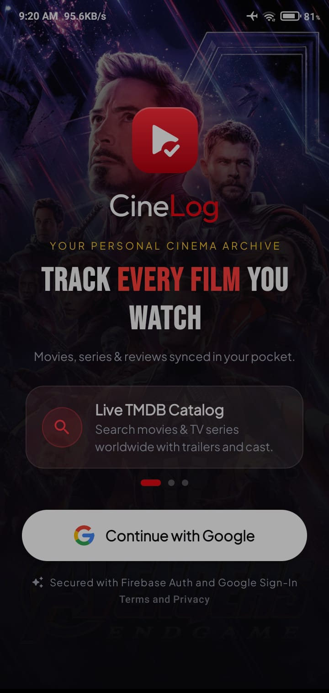
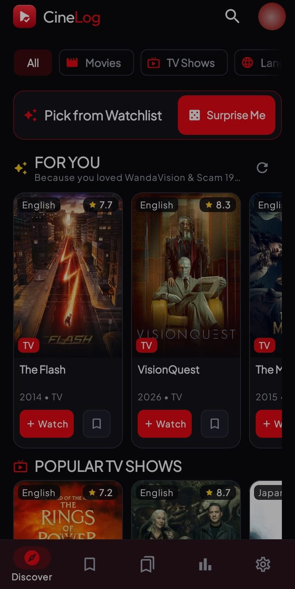
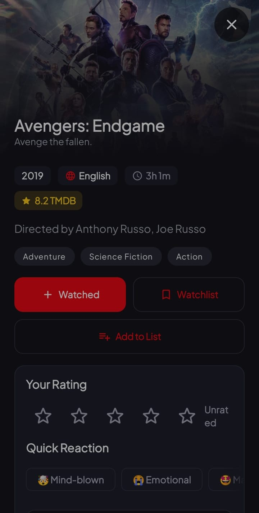
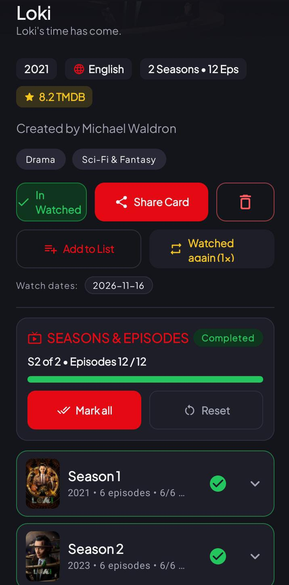
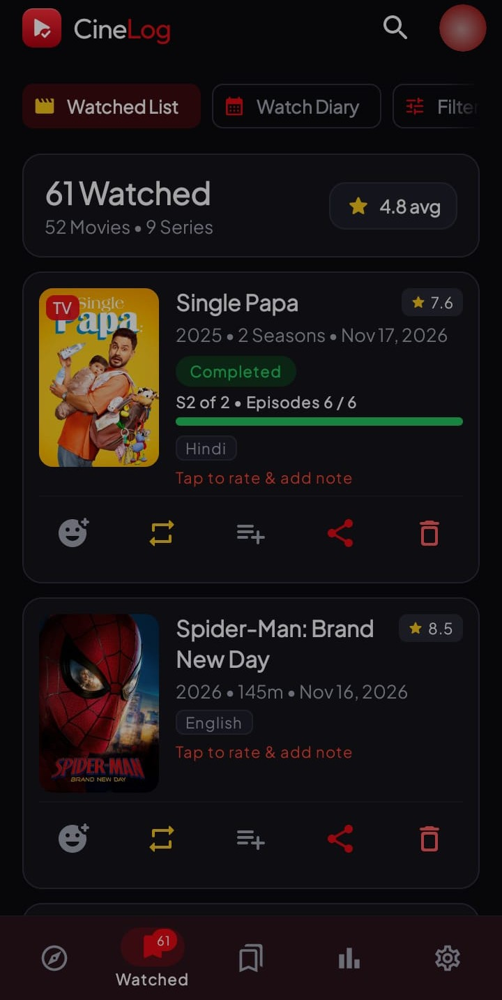
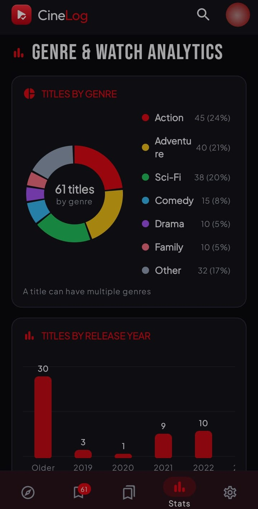
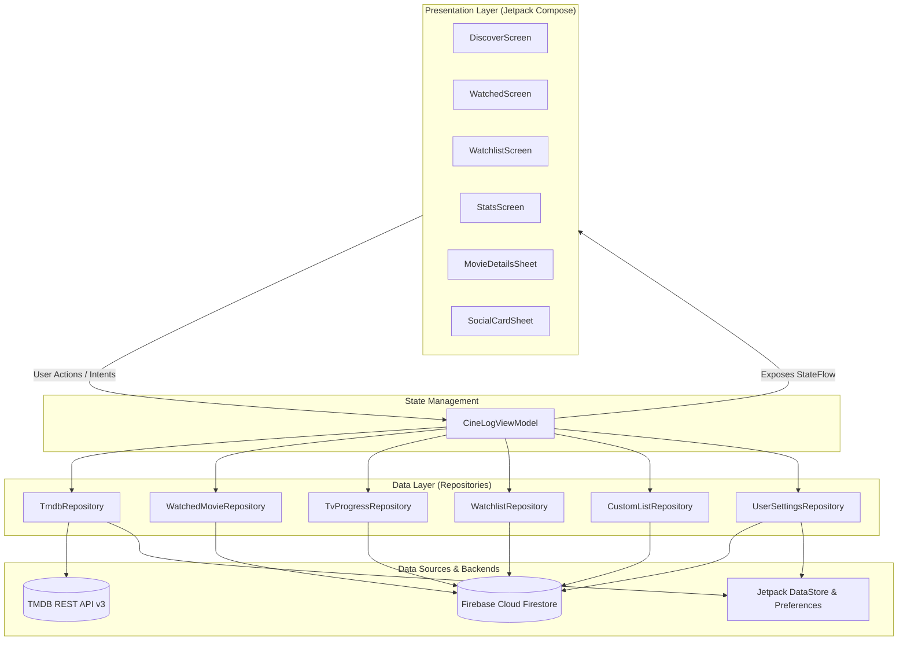

<div align="center">

  

  # CineLog

  **Your personal cinema archive: track every movie and series you watch.**

  [](https://kotlinlang.org/)
  [](https://developer.android.com/jetpack/compose)
  [](https://firebase.google.com/)
  [](https://www.themoviedb.org/documentation/api)
  [](https://android.com)
  [](https://android.com)
  [](LICENSE)
  [](https://github.com/himeshrana1137/CineLog/pulls)

  <p align="center">
    <a href="#about">About</a> •
    <a href="#screenshots">Screenshots</a> •
    <a href="#features">Features</a> •
    <a href="#tech-stack">Tech Stack</a> •
    <a href="#architecture">Architecture</a> •
    <a href="#getting-started">Setup</a> •
    <a href="#roadmap">Roadmap</a>
  </p>

</div>

---

## Table of Contents

- [About](#about)
- [Screenshots](#screenshots)
- [Features](#features)
  - [Authentication & Cloud Synchronization](#-auth-and-sync)
  - [Discovery & Smart Search](#-discover-and-search)
  - [Movie & Title Tracking](#-tracking)
  - [TV Series & Episode Progress](#-tv-tracking)
  - [Cinema Analytics & Statistics](#-stats)
  - [Extras & Visual Polish](#-extras)
- [Tech Stack](#tech-stack)
- [Architecture](#architecture)
- [Getting Started](#getting-started)
  - [Prerequisites](#prerequisites)
  - [Step-by-Step Setup](#step-by-step-setup)
  - [Firestore Data Hierarchy](#firestore-data-hierarchy)
  - [Running Unit & Emulator Tests](#running-tests)
- [Security Guidelines](#security-note)
- [Roadmap](#roadmap)
- [Contributing](#contributing)
- [License](#license)
- [Author](#author)
- [Acknowledgements & Legal Disclaimers](#acknowledgements-and-disclaimer)

---

## About

CineLog is a native Android cinema tracking platform crafted for moviegoers and TV series enthusiasts who want full ownership of their viewing history. Built with modern Android architecture and Jetpack Compose, it eliminates fragmented watchlists and scattered notes by consolidating your entire entertainment journey into a sleek, responsive personal archive. With real-time cloud synchronization, seamless offline caching, India OTT streaming availability, and deep analytics, CineLog delivers a fluid cinema companion on your mobile device.

---

## Screenshots

<!-- Place your actual app screenshots in docs/screenshots/ (e.g., login.png, discover.png, details.png, seasons.png, watched.png, stats.png) -->

| 🔐 Marvel Login & Showcase | 🔍 Discover & India OTT | 🎬 Rich Details & Trailer |
| :---: | :---: | :---: |
|  |  |  |
| **TV Seasons & Episodes** | **Watched Archive & Diary** | **Deep Cinema Analytics** |
|  |  |  |

---

## Features

### 🔐 Auth and sync
- **Modern Google Sign-In**: Powered by Android Credential Manager (`androidx.credentials` + `googleid`) and Firebase Auth.
- **Real-Time Cloud Sync**: Realtime Firestore synchronization via active snapshot listeners keeps your history updated across devices.
- **Offline-First Architecture**: 100 MB persistent Firestore cache coupled with a 150 MB Coil image disk cache for instant offline browsing.
- **Network State Awareness**: Live connectivity observer that presents a discreet status banner when operating offline.

### 🔍 Discover and search
- **Combined Movies & TV Search**: Unified exploration across the entire TMDB catalog with dedicated filters for All, Movies, and TV Shows.
- **Trending & Popular Feeds**: Dynamic carousels for weekly trending media and popular releases.
- **Personalized "For You"**: Algorithmic recommendations tailored from titles rated 4 stars or higher in your watched history.
- **"Surprise Me" Picker**: Quick decision assistant that randomly draws recommendations from your Watchlist with runtime and media type filters.
- **Regional & Language Filtering**: Filter by original audio language (Hindi, English, regional Indian cinema, foreign languages).
- **India OTT Streaming Providers**: View real-time Stream, Rent, and Buy provider badges for the India region (`IN`) powered by JustWatch data.
- **Embedded Video Previews**: Lazy-loaded YouTube trailers with season-preferred video selection via `android-youtube-player`.

### 🍿 Tracking
- **Dual Lists**: Dedicated Watched archive and Watchlist with single-tap status toggling from cards and details sheets.
- **Ratings & Personal Reviews**: Express your impressions with a 1-to-5 star rating bar and private review notes.
- **Quick Emoji Reactions**: Tag movies with quick reaction emojis (🤯 *Mind-blown*, 😭 *Emotional*, 🤩 *Masterpiece*, 😂 *Hilarious*, 😴 *Boring*) and filter your library by reaction.
- **Rewatch Counter & Watch Diary**: Track multiple viewings with a `+1` rewatch counter and revisit your journey via a monthly Watch Diary calendar.
- **Custom Curated Collections**: Create, rename, and manage custom themed lists with drag-and-drop or card additions.
- **Complete Data Portability**: Import your existing viewing logs from IMDb or Letterboxd CSV files (with automatic TMDB matching, resolution, and skip capabilities), and export your entire collection to standard CSV or JSON.

### 📺 TV tracking
- **Granular Season & Episode Checklists**: Check off individual episodes with interactive checkboxes; completing all episodes automatically marks the season watched.
- **Automated Series Status**: Dynamic lifecycle indicators designating shows as *Not started*, *Watching*, or *Completed*.
- **"Next Up" Guidance**: Context-aware indicators highlighting the immediate next season and episode on your schedule (e.g., `Next up: S2 E4`).
- **Catch-Up Workflow**: Prompting to automatically mark earlier unwatched seasons when checking Season N (N > 1), alongside global "Mark all" and "Reset" controls.
- **Refined Display**: Specials toggle collapsed by default, with unreleased or future seasons cleanly disabled.

### 📊 Stats
- **Screen Time Calculator**: Accurate watch-time totals converted into days and hours, using actual movie runtimes and episode-level duration fallbacks.
- **Interactive Visual Charts**:
  - Top Genres donut chart with center total tally.
  - Release Year distribution bar chart with "Older" and "Unknown" buckets.
  - User Rating frequency bar chart (1 to 5 stars plus unrated items).
  - Monthly viewing velocity line chart.
- **Cast & Crew Insights**: Top 25 actors and directors ranked by logged titles, with drill-down sheets showing every matched film or show.
- **Multi-Format Segmentation**: Toggle analytics views between All Media, Movies only, or TV Series only.

### ✨ Extras
- **Spoiler-Free Social Cards**: Export clean viewing summary graphics in 9:16 Story (1080x1920) or 1:1 Square (1080x1080) for Instagram, WhatsApp, or Twitter sharing without revealing notes or spoilers.
- **Phone Wallpaper Cropper**: Interactive pan-and-zoom 9:16 aspect ratio poster cropper with gallery save.
- **Custom Theme Accent Picker**: Personalize the app's visual identity with Cinema Red, Gold Yellow, Electric Blue, Royal Purple, Neon Green, or any custom `#RRGGBB` hex code.
- **Cinematic Login Wall**: Full-screen Marvel Studios poster slideshow (`with_companies=420`) with Ken Burns zoom, 24-hour cache, and trending fallback.
- **Polished Visual Identity**: Vector Canvas squircle gradient icon, custom brand typography wordmark, animated entry transition, and native Android 12+ splash screen.

---

## Tech Stack

| Layer | Technology | Details / Version |
| :--- | :--- | :--- |
| **Language** | Kotlin | `2.2.10` |
| **UI Framework** | Jetpack Compose | BOM `2024.09.00`, Material 3, Material Icons Extended |
| **Architecture** | MVVM + Repository Pattern | Clean Architecture with Unidirectional Data Flow (UDF) & StateFlow |
| **Asynchronous** | Kotlin Coroutines & Flow | `1.10.2` (Android & Core) |
| **Networking** | Retrofit & OkHttp | Retrofit `2.12.0`, OkHttp `4.10.0` with Logging Interceptor |
| **Serialization** | Moshi | `1.15.2` with KSP (`2.3.5`) Code Generation |
| **Image Loading** | Coil Compose | `2.7.0` with 150 MB disk cache |
| **Cloud Database** | Firebase Cloud Firestore | BOM `34.17.0` (with 100 MB persistent offline cache) |
| **Authentication** | Google Sign-In | Android Credential Manager (`1.5.0`), `googleid 1.1.1`, Firebase Auth |
| **Local Storage** | Jetpack DataStore & Preferences | DataStore Preferences `1.1.7` & SharedPreferences |
| **Video Player** | Android YouTube Player | `12.1.1` (`com.pierfrancescosoffritti.androidyoutubeplayer:core`) |
| **System Integration** | AndroidX Core Splashscreen | `1.2.0` |
| **Testing** | JUnit4, Robolectric, Coroutines Test | JUnit `4.13.2`, Robolectric `4.16.1`, AndroidX Test `1.3.0`, Firebase Emulator Suite |

---

## Architecture

CineLog adheres to Google's recommended Modern Android Architecture principles:
- **Presentation Layer**: Built completely in declarative Jetpack Compose. Screens observe single immutable UI state objects exposed via `StateFlow` from `CineLogViewModel`. User intents flow unidirectionally into the ViewModel.
- **Domain & State Management**: `CineLogViewModel` orchestrates business logic, filters, optimistic overrides for seamless UI toggles, and data aggregation.
- **Data Layer**: Clean Repository abstractions (`TmdbRepository`, `WatchedMovieRepository`, `TvProgressRepository`, `WatchlistRepository`, `CustomListRepository`, `UserSettingsRepository`). Repositories encapsulate remote REST interactions via Retrofit, real-time Firestore listeners, and local DataStore caches.



<details>
<summary>📁 Click to expand trimmed folder structure</summary>

```text
CineLog/
├── app/
│   ├── build.gradle.kts
│   └── src/
│       ├── main/
│       │   ├── AndroidManifest.xml
│       │   └── java/com/example/
│       │       ├── CineLogApplication.kt
│       │       ├── MainActivity.kt
│       │       ├── auth/           # Credential Manager & Google Auth
│       │       ├── data/
│       │       │   ├── firebase/   # Firestore provider & error handlers
│       │       │   ├── model/      # Data models & calculators
│       │       │   ├── remote/     # Retrofit TMDB API service & DTOs
│       │       │   └── repository/ # Repositories (TMDB, Watched, TV, Lists)
│       │       ├── ui/
│       │       │   ├── CineLogViewModel.kt
│       │       │   ├── components/ # Custom charts, logo, cards, video
│       │       │   ├── screens/    # Compose screens and bottom sheets
│       │       │   └── theme/      # Dynamic theme, colors, typography
│       │       └── util/           # Media saver, CSV import/export, network
│       └── test/                   # Unit, Robolectric & Firestore rule tests
├── docs/                           # Logo and app screenshots
├── firestore.rules                 # Cloud Firestore security rules
├── gradle/                         # Version catalog and wrapper
└── .env.example                    # Template for API keys
```
</details>

---

## Getting Started

### Prerequisites

- **Android Studio**: Ladybug (2024.2.1) or newer recommended.
- **Java Development Kit (JDK)**: JDK 17 or JDK 21 configured as Gradle JDK.
- **Android SDK Requirements**:
  - `minSdk`: **24** (Android 7.0 Nougat)
  - `compileSdk`: **36**
  - `targetSdk`: **36** (Android 16)

---

### Step-by-Step Setup

#### 1. Clone the Repository
```bash
git clone https://github.com/himeshrana1137/CineLog.git
cd CineLog
```

#### 2. Create and Configure Firebase Project
1. Navigate to the [Firebase Console](https://console.firebase.google.com/) and create a new project.
2. In the project dashboard, select **Add Android App**.
3. Register the package name:
   ```text
   com.aistudio.cinelog.mvrkqz
   ```
4. Generate your local debug SHA-1 and SHA-256 certificate fingerprints:
   ```bash
   ./gradlew signingReport
   ```
5. Copy the SHA-1 and SHA-256 fingerprints from the output and register them under your Android app in Firebase Project Settings (required for Google Sign-In via Credential Manager).
6. Enable **Authentication** in the Firebase Console:
   - Go to **Build > Authentication > Sign-in method**.
   - Enable **Google** sign-in provider.
7. Enable **Cloud Firestore**:
   - Go to **Build > Firestore Database** and click **Create database**.
8. Download the resulting `google-services.json` file and place it inside the `app/` directory:
   ```text
   app/google-services.json
   ```

#### 3. Configure TMDB API Key
1. Sign up for a free account at [The Movie Database (TMDB)](https://www.themoviedb.org/).
2. Request an API key under **Settings > API**.
3. Copy `.env.example` to `.env` in the project root:
   ```bash
   cp .env.example .env
   ```
4. Open `.env` (or `local.properties`) and specify your TMDB key using the property name expected by the Secrets Gradle Plugin:
   ```properties
   TMDB_API_KEY=your_actual_tmdb_api_key_here
   ```

#### 4. Deploy Firestore Security Rules
Ensure the Firebase CLI is installed (`npm install -g firebase-tools`) and logged in (`firebase login`), then deploy the production security rules:
```bash
firebase deploy --only firestore:rules
```

#### 5. Build and Run
Open the project in Android Studio, sync Gradle, and run the app on an Android device or emulator running API 24 or higher:
```bash
./gradlew :app:assembleDebug
```

---

### Firestore Data Hierarchy

<details>
<summary>🗄️ Click to expand Cloud Firestore collection schema</summary>

CineLog partitions all user collections under isolated user root documents (`users/{userId}`) protected by authentication checks:

```text
users/{userId}/
├── watched/{docId}
│   │   # docId is movieId (e.g. "550") for movies or "tv_{tvId}" for TV series
│   │   # Fields: userId, movieId, mediaType, title, rating, userRating,
│   │   #         note, reaction, watchLog, watchedAt, updatedAt, etc.
│   └── seasons/{seasonNumber}
│           # docId is seasonNumber (e.g. "1", "2")
│           # Fields: userId, tvId, seasonNumber, episodeCount,
│           #         watched, watchedEpisodes, watchedRuntimeMinutes, updatedAt
│
├── watchlist/{docId}
│       # docId is movieId or "tv_{tvId}"
│       # Fields: userId, movieId, mediaType, title, rating, addedAt, updatedAt
│
├── lists/{listId}
│       # Custom lists created by the user
│       # Fields: userId, name, description, items, createdAt, updatedAt
│
└── settings/preferences
        # User UI preferences and migration flags
        # Fields: userId, accentPreset, accentHex, tvMigrationCompleted, updatedAt
```
</details>

---

### Running Tests

CineLog includes a comprehensive unit and rule verification suite spanning view models, statistics calculators, import/export parsers, and Firestore security rules.

#### Gradle Unit Tests
Run the standard unit test suite with plain console output:
```bash
./gradlew :app:testDebugUnitTest --console=plain
```

#### Firebase Emulator Suite Audit
To execute tests validating Firestore rules and repository flows against local Firebase emulators (as used during the repository audit):
```bash
firebase emulators:exec --only firestore,auth --project demo-no-project "./gradlew :app:testDebugUnitTest --console=plain"
```

---

## Security Note

CineLog is designed with private credential isolation. The following configuration files and credentials contain sensitive keys or tokens and **must never be committed to source control**:

- `app/google-services.json` (Firebase client configuration)
- `local.properties` (Local SDK directories and local keys)
- `.env` (Private environment secrets)
- Keystore files (`*.jks`, `*.keystore`, `debug.keystore`)

The project's `.gitignore` file is strictly configured to exclude all of these patterns. Always inspect `git status` before committing to ensure no private key or credential file is staged.

---

## Roadmap

### Completed Milestones
- [x] Modern Google Sign-In via Android Credential Manager
- [x] Full TMDB search & discovery for Movies and TV Series
- [x] Real-time cloud synchronization with Firebase Cloud Firestore
- [x] 100 MB persistent offline Firestore cache and 150 MB Coil image disk cache
- [x] Granular TV show tracking with season-wise and episode-wise progress
- [x] Automated series state computation (*Not started* / *Watching* / *Completed*) and "Next Up" indicator
- [x] India OTT watch providers integration (JustWatch TMDB data)
- [x] In-depth analytics dashboard (Screen time, Genre donut, Release year, Ratings, Monthly trend)
- [x] Top 25 actors and directors analytics with detail drill-down
- [x] Rewatch counter and monthly Watch Diary calendar
- [x] Custom curated user collections
- [x] IMDb & Letterboxd CSV import and CineLog CSV/JSON export
- [x] Spoiler-free social card generation (Story 9:16 & Square 1:1)
- [x] Pan-and-zoom 9:16 phone wallpaper cropper
- [x] Dynamic theme accent color customization
- [x] Animated Marvel poster slideshow login background
- [x] Comprehensive unit and emulator-backed security rule test coverage

### Planned Enhancements
- [ ] **CineLog Wrapped**: Yearly retrospective showcasing personal watch records, standout genres, and milestone dates.
- [ ] **Yearly Goals & Streaks**: Set custom annual viewing targets and maintain daily/weekly tracking streaks.
- [ ] **Achievements & Badges**: Unlock collectible badges for cinema milestones (e.g., franchise completions, decade deep-dives).
- [ ] **Franchise Tracker**: Dedicated progress tracker for cinematic universes and long-running film series.

---

## Contributing

Contributions, bug reports, and suggestions are welcome!

1. Fork the repository.
2. Create a feature branch:
   ```bash
   git checkout -b feature/your-feature-name
   ```
3. Commit your changes using clear, descriptive commit messages:
   ```bash
   git commit -m "feat: add support for custom watchlist sorting"
   ```
4. Verify that all unit tests pass:
   ```bash
   ./gradlew :app:testDebugUnitTest
   ```
5. Push to your branch and submit a Pull Request.

---

## License

Distributed under the **MIT License**. See [LICENSE](LICENSE) for details.

---

## Author

**Himesh Rana**
- GitHub: [@himeshrana1137](https://github.com/himeshrana1137)
- LinkedIn: [linkedin.com/in/himeshrana](https://linkedin.com) *(Update with your personal profile)*
- Email: `himeshrana1137@example.com` *(Update with your contact email)*

---

## Acknowledgements and Disclaimer

- **TMDB**: This product uses the TMDB API but is not endorsed or certified by TMDB.
- **JustWatch**: Streaming availability data provided by JustWatch via TMDB.
- **Fair Use Notice**: Movie and series posters, titles, backdrops, and studio logos belong to their respective copyright holders and are utilized for non-commercial, educational purposes.
- **Open-Source Credits**: Special thanks to the maintainers of the open-source libraries that make CineLog possible:
  - [Coil](https://coil-kt.github.io/coil/) (Asynchronous image loading)
  - [Firebase Android SDK](https://firebase.google.com/docs/android/setup) (Authentication & Cloud Firestore)
  - [android-youtube-player](https://github.com/PierfrancescoSoffritti/android-youtube-player) (Seamless YouTube trailer streaming)
  - [Retrofit](https://square.github.io/retrofit/) & [OkHttp](https://square.github.io/okhttp/) (Type-safe HTTP client)
  - [Moshi](https://github.com/square/moshi) (Modern JSON library for Kotlin)
  - [Jetpack Compose](https://developer.android.com/jetpack/compose) & Material 3 (Modern declarative Android UI)

---

<div align="center">
  <sub>Built with ❤️ for cinema lovers everywhere. If you find CineLog helpful, please consider leaving a ⭐️ on GitHub!</sub>
</div>
